  

### `$ ls ~/projets`

| Projet | Description | Stack |
|---|---|---|
| [**ChooseMyCocktail**](https://github.com/nicoco23/ChooseMyCocktail) | Accords mets & boissons | Next.js · Express · SQLite |
| [**qlcplus**](https://github.com/nicoco23/qlcplus) | Fork de QLC+ façon console ChamSys MagicQ, piloté à l'Akai APC mini | C++ · Qt |
| **Altiora** | App mobile de productivité | React Native · Expo |
| **ft_transcendence** | Projet final du tronc commun 42 | TypeScript |

### `$ cat stack.txt`

  

### `$ ./contact.sh`

  
  

